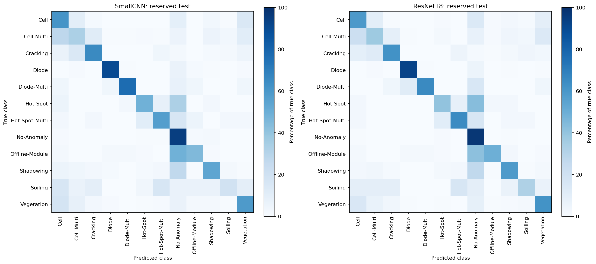

# ENGG2112: thermal solar-panel fault classification

We compare compact CNNs and pretrained ResNet18 on 12 classes of thermal solar-module images. The goal is to support further inspection and reuse assessment. Predictions do not certify panel safety or suitability for reuse.


## Final held-out results

| Model | Test accuracy | Test macro-F1 | Screening recall | Normal false alarms |
|---|---:|---:|---:|---:|
| Majority baseline | 50.07% | 0.0556 | 0.00% | 0.00% |
| SmallCNN | 76.51% | 0.5957 | 89.68% | 7.62% |
| Standard augmented ResNet18 | 78.85% | 0.6232 | 89.48% | 4.75% |

Models and screening cutoffs were frozen before inference on 2,988 test images. Both learned models narrowly missed the 90% screening-recall target; cutoffs were not retuned. Screening and 12-class argmax predictions are separate decisions.

A subsequent [paired group-bootstrap comparison](results/final-model-comparison-v1.md) estimates the macro-F1 gap (ResNet − CNN) at **+0.0275**, with a 95% interval of **+0.0020 to +0.0524**. This supports a positive gap for these frozen checkpoints on this benchmark; it does not establish performance across training seeds or unseen sites. ResNet has about **234×** the parameters and **7.3×** the measured batch-one latency of SmallCNN on our local CPU benchmark; these are not measurements on an edge device. The observed gain remains below the proposal draft's +0.05 target.



[Complete final results and limitations](results/final-evaluation-v1.md).

## Read the project

1. [Data exploration](notebooks/01_data_exploration.ipynb): image properties, imbalance, cleaning and frozen splits.
2. [CNN baseline](notebooks/02_baseline_experiments.ipynb): model design, useful comparisons, two retained references and errors.
3. [ResNet experiments](notebooks/03_resnet18_experiments.ipynb): transfer learning, controlled spatial variants, remaining errors and compute cost. Sections **8–10** cover final test evaluation and paired comparison, Grad-CAM, and validation crop robustness.

The experiment notebooks display recorded results without training. Their image examples are optional; notebook 01 requires the local dataset. Executed plots remain visible on GitHub.

## Run locally

```bash
python -m pip install -r requirements.txt
jupyter notebook
```

Recorded runs used **Python 3.9.6** on macOS. `requirements.txt` pins the direct dependencies to that verified environment; transitive dependencies and other platforms are not fully locked.

Launch from the repository root. Follow [data setup](data/README.md) before loading images or fitting models. The six [current recipes](configs/README.md) describe the retained CNN references, frozen ResNet parent and three ResNet spatial variants.

```bash
PYTHONPATH=src python -m unittest discover -s tests
PYTHONPATH=src python scripts/create_split.py --verify-only
PYTHONPATH=src python scripts/train_baseline.py
PYTHONPATH=src python scripts/fetch_resnet18_weights.py --verify-only
PYTHONPATH=src python scripts/train_resnet18.py
PYTHONPATH=src python scripts/finetune_resnet18.py
```

Training commands default to two-batch diagnostics. Full fitting requires `--full`, a new run ID in a copied plan, and the exact recorded inputs/parent checkpoint. Existing full runs cannot be overwritten. Download missing ImageNet weights with `PYTHONPATH=src python scripts/fetch_resnet18_weights.py` before ResNet diagnostics.

## Evidence and history

- [Paired comparison](results/final-model-comparison-v1.md): uncertainty in the frozen ResNet–CNN macro-F1 gap.
- [Final reserved-test results](results/final-evaluation-v1.md): frozen choices, per-class metrics, screening performance and group-bootstrap intervals.

- [CNN error review](results/cnn-error-review-v1.md): higher macro-F1 versus fewer missed faults.
- [ResNet spatial comparison](results/resnet18-spatial-v1.md): performance, feature geometry and actual compute measurements.
- [Experiment archive](archive/README.md): older recipes, reporting tools and detailed trial records.

Historical JSON records, figures, frozen splits and archived producer sources are preserved. Shared code handles setup, source snapshots, fitting, validation and plotting. Current training uses one validation pass per epoch and verifies every saved probability after reloading the selected checkpoint; older reported timings describe their original producers.

These are mainly single-seed, validation-selected experiments. The duplicate-aware split has no verified site/panel identifiers; it cannot establish unseen-site performance. The one-time reserved-test evaluation of frozen choices is [recorded here](results/final-evaluation-v1.md). Raw data, checkpoints, environments and full local runs stay outside Git.

## Final reserved-test evaluation

The frozen protocol and completed results are retained. The commands below document the sequence used; they intentionally refuse to overwrite an existing protocol or started test evaluation.

`scripts/evaluate_final.py` freezes the majority baseline, selected SmallCNN and standard augmented ResNet. It reproduces saved validation probabilities and selects each learned model's binary screening threshold on validation only: the highest cutoff achieving at least 90% anomaly recall, with the resulting false-alarm rate checked against 20%. Infeasible targets are recorded honestly.

```bash
PYTHONPATH=src python scripts/evaluate_final.py freeze
```

Review and commit `configs/final-evaluation-v1.json` together with its evaluation code before running:

```bash
PYTHONPATH=src python scripts/evaluate_final.py test
```

The test command requires the committed protocol, unchanged code/environment, matching checkpoint fingerprints and the verified dataset. It records a start marker before loading test images and refuses to overwrite any started or completed evaluation. If execution fails after that marker, preserve the partial folder and review what was exposed before continuing; do not delete it to rerun model selection.

Multiclass argmax predictions and threshold-based anomaly screening are scored separately. Results include per-class metrics, confusion matrices and seeded 95% bootstrap intervals resampling detected related-image groups. Group intervals do not establish independent-site generalisation. Compact results and figures go under `results/final-evaluation-v1*`; full prediction vectors stay in ignored `runs/final-evaluation-v1/`.

## Validation crop robustness

The ResNet notebook also checks fixed shifts, small rotations, blur and resolution loss on validation crops using the frozen model and screening cutoff. The [compact record](results/resnet18-validation-robustness-v1.json) preserves the declared operations and measured changes. These are synthetic sensitivity checks, not camera acceptance limits or end-to-end inspection results. No retraining or test inference occurs.

With retained local data and checkpoints, run `PYTHONPATH=src python scripts/check_validation_robustness.py` deliberately; existing records are protected from overwrite.

## Attribution and AI assistance

Git authors are Tom Wait (also recorded as Thomas Wait) and Ethan Melton (also recorded as ethanmelton1). `.mailmap` consolidates those identities without rewriting history. The available proposal draft also lists Iris Li and Anushka Ram; the [contribution worksheet](docs/contributions.md) records proposed roles for team confirmation. Git author records do not establish the full division of team work or intellectual authorship.

[AI assistance record](docs/ai_usage.md) documents substantial Codex assistance and automated verification. It is a working summary; the team must retain original prompts/outputs and complete the required report appendix and contribution statement before submission.

The [report scaffold](docs/report_outline.md) follows the supplied LaTeX section order and marking criteria, with topic prompts and a suggested ten-page body budget.
