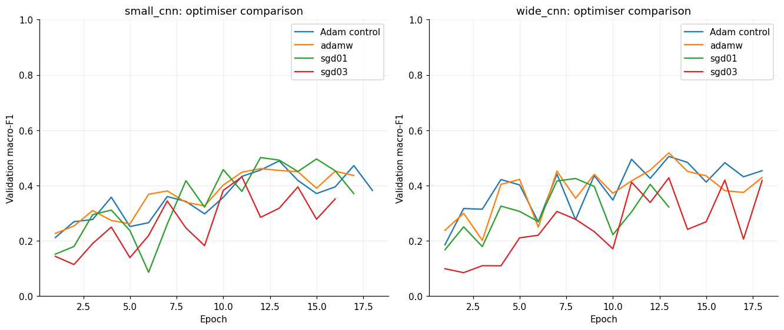

# CNN optimiser follow-up: AdamW and mini-batch SGD

This follows the closed timed search. No second-seed checks were requested or run. All trials use seed 2112 and original training/validation partitions only; no test inference.

The reference architecture for each size is its two-convolution ReLU model with BatchNorm. Compare AdamW at 0.001 and decay 0.0001, and SGD with momentum 0.9 at rates 0.01 and 0.03, against prior Adam at 0.001 with zero decay. Batch size 64, square-root inverse-frequency training loss weights, max 30 epochs, patience five and 300-second caps stay fixed. No scheduler or augmentation. SGD remains mini-batch training; changing optimiser does not change batch size. AdamW changes optimiser and adds regularisation, so this arm does not isolate either effect alone.

## Results

| Model | Optimiser | LR | Accuracy | Macro-F1 | Balanced accuracy | Missed faults / 1,492 | Normal false alarms / 1,496 | Epochs / best | Stop |
|---|---|---:|---:|---:|---:|---:|---:|---:|---|
| small_cnn | Adam control | 0.001 | 0.6523 | 0.4888 | 0.5324 | 152 | 349 | 18 / 13 | early_stopping |
| small_cnn | adamw | 0.001 | 0.6647 | 0.4609 | 0.4701 | 278 | 209 | 17 / 12 | early_stopping |
| small_cnn | sgd01 | 0.01 | 0.6961 | 0.5010 | 0.4818 | 328 | 135 | 17 / 12 | early_stopping |
| small_cnn | sgd03 | 0.03 | 0.6573 | 0.4312 | 0.4023 | 448 | 149 | 16 / 11 | early_stopping |
| wide_cnn | Adam control | 0.001 | 0.6727 | 0.5051 | 0.5627 | 129 | 334 | 18 / 13 | early_stopping |
| wide_cnn | adamw | 0.001 | 0.6784 | 0.5179 | 0.5528 | 137 | 304 | 18 / 13 | early_stopping |
| wide_cnn | sgd01 | 0.01 | 0.6473 | 0.4253 | 0.4432 | 351 | 234 | 13 / 8 | early_stopping |
| wide_cnn | sgd03 | 0.03 | 0.6687 | 0.4280 | 0.4276 | 340 | 146 | 18 / 13 | early_stopping |

## Decisions

- **small_cnn:** highest validation macro-F1 among this control and completed optimiser arms is **0.5010** from `smallcnn-optimizer-sgd01-s2112-v1`. See error counts before retaining any change; ranking is single-seed development evidence.
- **wide_cnn:** highest validation macro-F1 among this control and completed optimiser arms is **0.5179** from `widecnn-optimizer-adamw-s2112-v1`. See error counts before retaining any change; ranking is single-seed development evidence.

## Limits and reproducibility

- The previous deeper CNNs are contextual references, not matched controls for optimiser effects because they have an additional layer. A promising optimiser could later be tested on those architectures with a new explicit plan.
- The controls are prior recorded BatchNorm runs under the preserved default architecture and same environment, not newly retrained controls. Every completed new trial reloaded its checkpoint and reproduced saved validation predictions exactly; source snapshots were checked against recorded hashes.
- Time caps/early stopping may produce different epoch counts. These are bounded practical comparisons and do not establish that one optimiser is universally better, especially if a candidate is still learning at its cap.
- Validation has been reused for selection. No independent seed confirmation or unseen-site claim follows. The test partition remains reserved for a frozen final evaluation.
- Full checkpoints/predictions/source snapshots stay in ignored runs folders. The tracked JSON contains shareable histories, metrics, plans and status ledger; pending/failed entries have no claimed result.
- The baseline notebook documents the rationale, settings, plots and resulting decisions in its optimiser follow-up section.

## Comparison with the previous deeper models

- **small_cnn:** best new optimiser arm `smallcnn-optimizer-sgd01-s2112-v1` reached macro-F1 0.5010; the previous deeper model `smallcnn-search-bn-depth-s2112-v1` remains higher at 0.5964. These are different architectures, so this is context rather than an isolated optimiser comparison.
- **wide_cnn:** best new optimiser arm `widecnn-optimizer-adamw-s2112-v1` reached macro-F1 0.5179; the previous deeper model `widecnn-search-bn-depth-s2112-v1` remains higher at 0.5500. These are different architectures, so this is context rather than an isolated optimiser comparison.

The earlier deeper WideCNN checkpoint remains provisional because its trial was externally interrupted and recovered. None of the new optimiser arms justifies replacing the leading recorded deeper configuration on validation macro-F1.

