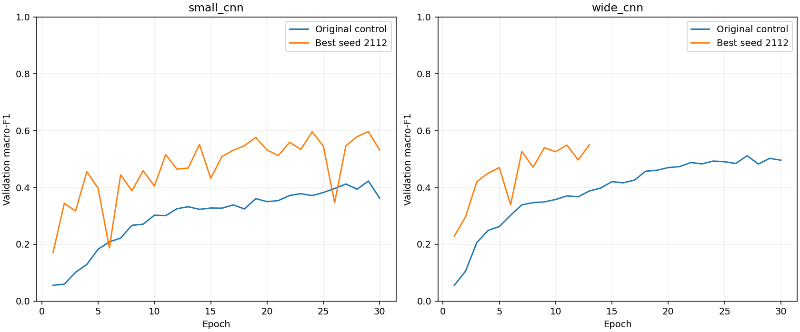

# Small/Wide CNN optimisation — 45-minute development budget

Budget: 23 October 2026, 15:54:52–16:39:52 Australia/Sydney. The search ledger records UTC wall timestamps and individual run summaries record active elapsed training/evaluation time. These measures can differ; do not treat the full wall-clock window as continuous model compute.

The frozen original training and validation partitions were used. The original test set was not evaluated. Selection prioritised validation macro-F1 while preserving balanced accuracy, per-class recall, missed faults, normal false alarms, parameter counts and timings. This is a bounded adaptive development search, not proof of a globally optimal CNN.

## Leading results

**WideCNN is provisional:** its run was interrupted by the external guard. We recovered the saved checkpoint and exactly verified its validation predictions without further training. The table reports that checkpoint, not completion of the planned budget. No second-seed checks completed. AdamW, SGD and combination plans remained unrun; no performance claim is made for them.

| Model | Role | Seed | Accuracy | Macro-F1 | Balanced accuracy | Faults called normal / 1,492 | Normal false alarms / 1,496 |
|---|---|---:|---:|---:|---:|---:|---:|
| small_cnn | Original control | 2112 | 0.6412 | 0.4224 | 0.4293 | 343 | 245 |
| small_cnn | Best development candidate | 2112 | 0.7413 | 0.5964 | 0.6183 | 82 | 240 |
| wide_cnn | Original control | 2112 | 0.6914 | 0.5114 | 0.5183 | 258 | 199 |
| wide_cnn | Best development candidate | 2112 | 0.7313 | 0.5500 | 0.5637 | 149 | 179 |

## Configurations and decisions

### small_cnn: `smallcnn-search-bn-depth-s2112-v1`

BatchNorm=True, activation=relu, extra same-width convolution=True, optimizer=adam, initial LR=0.001, decay=0.0, scheduler=none. Trainable parameters: 47,820.

Compared with the original 30-epoch control: macro-F1 +0.1740; missed faults -261; normal false alarms -5. Best epoch 29 of 30 completed; stop reason `max_epochs`.

Weakest three classes by recall: Hot-Spot 0.405, Cell-Multi 0.409, Soiling 0.419.

### wide_cnn: `widecnn-search-bn-depth-s2112-v1`

BatchNorm=True, activation=relu, extra same-width convolution=True, optimizer=adam, initial LR=0.001, decay=0.0, scheduler=none. Trainable parameters: 486,540.

Compared with the original 30-epoch control: macro-F1 +0.0386; missed faults -109; normal false alarms -20. Best epoch 13 of 13 completed; stop reason `external_guard_interrupted_then_checkpoint_verified`.

Weakest three classes by recall: Hot-Spot 0.297, Cell-Multi 0.316, Offline-Module 0.407.

## What was tested

The initial scheduler/BatchNorm ablations are recorded separately in `cnn-scheduler-batchnorm-v1.md`. Further planned arms used BatchNorm as the reference and tested GELU, an additional same-channel convolution without another pooling step, AdamW with decay 0.0001, and SGD momentum 0.9 at initial rates 0.01/0.03. Only completed entries below have results. Combinations and seed checks were selected adaptively and are identified in the ledger.

| Run | Phase | Status | Macro-F1 when completed |
|---|---|---|---:|
| smallcnn-search-bn-gelu-s2112-v1 | single_change | completed | 0.5549 |
| widecnn-search-bn-gelu-s2112-v1 | single_change | completed | 0.5095 |
| smallcnn-search-bn-depth-s2112-v1 | single_change | completed | 0.5964 |
| widecnn-search-bn-depth-s2112-v1 | single_change | interrupted_checkpoint_recovered_and_verified | 0.5500 |
| smallcnn-search-bn-adamw-s2112-v1 | single_change | not_run_budget_reserved | — |
| widecnn-search-bn-adamw-s2112-v1 | single_change | not_run_budget_reserved | — |
| smallcnn-search-bn-sgd01-s2112-v1 | single_change | not_run_budget_reserved | — |
| widecnn-search-bn-sgd01-s2112-v1 | single_change | not_run_budget_reserved | — |
| smallcnn-search-bn-sgd03-s2112-v1 | single_change | not_run_budget_reserved | — |
| widecnn-search-bn-sgd03-s2112-v1 | single_change | not_run_budget_reserved | — |
| smallcnn-search-bn-depth-s42-v1 | second_seed | not_run_budget_reserved | — |
| widecnn-scheduler-s42-v1 | second_seed | not_run_budget_reserved | — |

## Interpretation and limits

- A change can improve macro-F1 while increasing one error type. Preserve the counts rather than describing any candidate as better in every respect.
- Reference arms use the same batch size, class weighting, seed and epoch/time policy. Early stopping and time caps can yield different completed epochs. SGD learning rates differ intentionally; this is a limited optimiser comparison rather than exhaustive tuning.
- GELU changes all ReLU activations in convolution blocks and the hidden classifier. Extra depth adds a same-width convolution before adaptive pooling and does not add further downsampling. It increases parameter count; seed equality does not imply all differently shaped architectures have identical initial tensors.
- The primary leaderboard is selected on a repeatedly reused validation set. Another seed measures sensitivity but uses the same validation examples. Where no matched seed-42 control exists, a second-seed result is not a paired estimate of improvement. Additional training-only cross-validation or replication is needed before stronger claims.
- Duplicate-aware separation does not establish unseen-site/panel performance because independent panel/site/capture identifiers are absent. Class predictions and routing are not repair or safety decisions.

## Verification and files

- 23 tests ran: 21 passed, two existing tests skipped. The suite checks original parameter counts, initialisation preservation for BatchNorm, validation running-stat isolation, finite gradients, checkpoint roundtrips, optimiser settings and scheduler timing.
- Every completed full trial reloaded its checkpoint and reproduced saved validation predictions exactly. New source snapshots were verified against recorded hashes; older reference runs retain their original hash records.
- Checkpoints, complete predictions and source snapshots are under ignored `runs/`; shareable histories, metrics and provenance are in `cnn-search-45min-v1.json`. The CSV contains a compact leading-result table.
- The baseline notebook contains the initial choice, all preceding experiment stages, the scheduler/BatchNorm comparison, the timed-search protocol, detailed results, learning curves and decisions. It does not launch full training unless explicitly requested by a notebook call.
- Reproduce a completed plan with `PYTHONPATH=src python scripts/train_baseline.py --plan PATH_TO_PLAN --full` in the project environment after data verification. Plans refuse to overwrite completed run folders. Use the checkpoint model/BatchNorm/activation/depth metadata when reconstructing a model.

