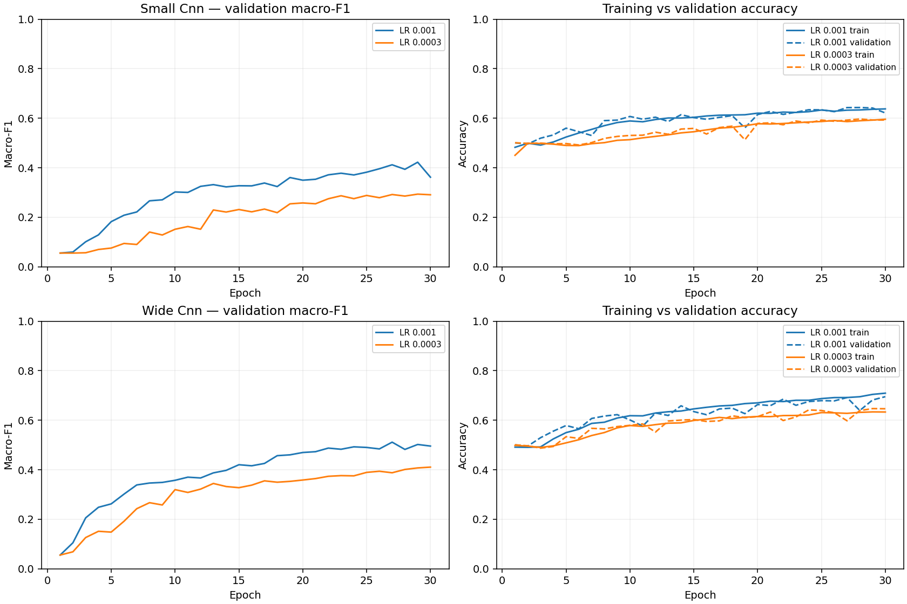

# CNN training budget and learning-rate comparison — 23 October 2026

Four local CPU runs compared the existing two-convolution SmallCNN (38,412 parameters) and WideCNN (338,316 parameters), each at Adam learning rates 0.001 and 0.0003. Architecture, initial seed 2112, batch 64, training-only square-root inverse-frequency loss weighting and frozen split were held fixed. No augmentation, scheduler, dropout or batch normalisation was added. Each run allowed up to 30 epochs, five non-improving validation macro-F1 epochs, and 300 seconds checked between epochs. Checkpoint verification and selected-training evaluation add post-training overhead.

## Recorded outcomes

| Model | LR | Epochs / best | Stop | Accuracy | Macro-F1 | Balanced accuracy | Faults called normal / 1,492 | Normal false alarms / 1,496 |
|---|---:|---:|---|---:|---:|---:|---:|---:|
| small_cnn | 0.001 | 30 / 29 | max_epochs | 0.6412 | 0.4224 | 0.4293 | 343 | 245 |
| small_cnn | 0.0003 | 30 / 29 | max_epochs | 0.5927 | 0.2935 | 0.3035 | 537 | 201 |
| wide_cnn | 0.001 | 30 / 27 | max_epochs | 0.6914 | 0.5114 | 0.5183 | 258 | 199 |
| wide_cnn | 0.0003 | 30 / 30 | max_epochs | 0.6463 | 0.4106 | 0.4082 | 368 | 204 |



## Learning beyond epoch 15

This compares the best score within the first 15 epochs against the best score in the same fresh run. It is descriptive, not a reproduction of the earlier patience-two experiments.

| Model | LR | Best macro-F1 through epoch 15 | Best overall | Selected train accuracy | Selected validation accuracy |
|---|---:|---:|---:|---:|---:|
| small_cnn | 0.001 | 0.3318 | 0.4224 | 0.6451 | 0.6412 |
| small_cnn | 0.0003 | 0.2314 | 0.2935 | 0.5961 | 0.5927 |
| wide_cnn | 0.001 | 0.4203 | 0.5114 | 0.7049 | 0.6914 |
| wide_cnn | 0.0003 | 0.3446 | 0.4106 | 0.6522 | 0.6463 |

Training curves show online accuracy during parameter updates. The selected-training accuracy above is a separate evaluation of the restored best checkpoint. Training uses weighted loss and validation unweighted loss, so their logged losses should not be directly compared. The separately saved selected-training loss is unweighted.

## Interpretation

Within this 30-epoch, single-seed comparison, learning rate 0.001 outperformed
0.0003 for both architectures. Extending the observed trajectories beyond epoch
15 improved best macro-F1 from 0.3318 to 0.4224 for SmallCNN and from 0.4203 to
0.5114 for WideCNN at 0.001. All four runs reached the epoch cap, so these runs do
not establish convergence or prove that a lower rate could never catch up with
more training.

WideCNN at 0.001 was the strongest CNN in this comparison: accuracy 0.6914,
macro-F1 0.5114, and 258 faults called normal out of 1,492. Relative to the older
reported WideCNN result (0.3975 macro-F1, 458 missed faults), this is encouraging,
but normal false alarms also increased from 136 to 199. Historical comparisons
are not controlled reruns because prior run artifacts and environment are not
available here. SmallCNN's macro-F1 improved relative to its older report, but
its missed faults were 343 versus the older 336.

For the restored 0.001 checkpoints, training versus validation accuracy was
0.6451 versus 0.6412 (SmallCNN) and 0.7049 versus 0.6914 (WideCNN). These small
gaps do not suggest a large accuracy overfitting gap, but do not rule out
class-specific overfitting. Cell-Multi and Hot-Spot remain weak for WideCNN,
with validation recall 0.254 and 0.243. Keep 0.001 as the reference rate for
any subsequent bounded augmentation or architecture comparison; do not assume
that higher accuracy alone resolves missed anomalies.

## Checks

The existing suite ran 18 tests: 16 passed and two were skipped (the existing
placeholder checkpoint unit test and a ResNet test requiring locally absent
pretrained weights). The four real CNN runs separately verified checkpoint
prediction equality. Full split verification passed before training, recorded
source hashes match the current source files, and `git diff --check` passed.

## Provenance and limits

- Each restored checkpoint reproduced every saved validation prediction, including probability vectors, exactly in the same environment.
- The manifest, metadata, related groups and image bytes passed `create_split.py --verify-only`. No test image inference or test-based selection was performed.
- Earlier CNN checkpoints/histories were not present in the Projects checkout or the earlier ChatGPT checkout. Historical rounded metrics remain context only. Git history and parameter counts confirm two convolution layers; the earlier three-width report description was corrected.
- This is a single-seed exploratory comparison using an already-reused validation partition. Differences are not confidence intervals or evidence of unseen-site performance. Keep any final model choice fixed before held-out testing.
- Full checkpoints, predictions and logs remain under ignored `runs/` folders. The tracked JSON contains histories, metrics, environment/source hashes and checkpoint fingerprints; it does not contain weights or image-level predictions.

## Reproduce

After preparing the dataset, activate the project environment. For each of the four plans under `configs/experiment-plan-{small,wide}cnn-extended-{lr1e-3,lr3e-4}.json`, run the following command (replace `PLAN` with one actual filename):

```bash
PYTHONPATH=src python scripts/train_baseline.py --plan PLAN
PYTHONPATH=src python scripts/train_baseline.py --plan PLAN --full
```

Existing run folders are never overwritten. To repeat on another seed or environment, use new run identifiers and record a new comparison.
