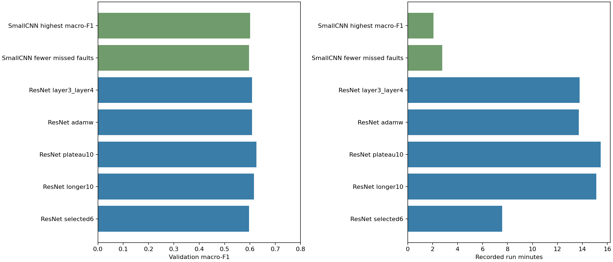

# ResNet18 one-hour optimisation and compute record

User-requested window: 27 October 2026, 10:13:11–11:13:11 Australia/Sydney (23:13:11–00:13:11 UTC). Initial selected6/longer10/plateau10 experiments were already in progress when this window started; their full run times include work outside the hour. The test split was not evaluated.

## What we tested

The initial comparison reproduced the documented stronger six-epoch rates, increased the allowance to ten epochs, then tested plateau scheduling under matched ten-epoch caps. It is recorded separately in `resnet18-optimisation-v1.md`. Both longer trials preserved the selected6 validation-score prefix exactly.

The adaptive phase started from the best verified longer configuration. AdamW adds declared weight decay 1e-4. Layer3+layer4 adaptation trains an additional residual stage with smaller layer3 rate 1e-5, keeping earlier stages and all BatchNorm fixed. Exact controls and budgets are saved in the plans; the layer3 arm may inherit AdamW if that preceding arm won.

Adaptive wall caps were 780 seconds checked between epochs, with an external guard and documentation reserve. The layer3 arm allows eight rather than ten epochs because of its compute cost; compare complete configurations rather than attributing every difference only to capacity. Mild augmentation was a candidate, not an executed trial.

## Validation results

| Model | Macro-F1 | Accuracy | Balanced accuracy | Missed faults / 1,492 | Normal false alarms / 1,496 |
|---|---:|---:|---:|---:|---:|
| ResNet selected6 | 0.5965 | 0.7687 | 0.5705 | 206 | 72 |
| ResNet longer10 | 0.6158 | 0.7838 | 0.5816 | 217 | 52 |
| ResNet plateau10 | 0.6261 | 0.7908 | 0.5966 | 196 | 55 |
| ResNet adamw | 0.6080 | 0.7704 | 0.5980 | 141 | 137 |
| ResNet layer3_layer4 | 0.6087 | 0.7801 | 0.5774 | 204 | 58 |
| SmallCNN fewer missed faults | 0.5964 | 0.7413 | 0.6183 | 82 | 240 |
| SmallCNN highest macro-F1 | 0.6012 | 0.7634 | 0.5934 | 170 | 112 |

Best verified macro-F1: **plateau10**, **0.6261**, from `resnet18-optim-plateau10-s2112-v1`. Difference from the SmallCNN macro-F1 reference: **+0.0249**; missed faults **+26**, normal false alarms **-57**.

## Candidate ledger

| Candidate | Status |
|---|---|
| adamw | completed_verified |
| layer3_layer4 | completed_verified |
| mild_augmentation | not_run_budget_priority |

## Time and compute

| Model | Run minutes | Completed / selected epoch | Mean run seconds / epoch | Trainable / total parameters |
|---|---:|---:|---:|---:|
| ResNet selected6 | 7.58 | 6 / 6 | 75.80 | 8,394,764 / 11,182,668 |
| ResNet longer10 | 15.12 | 10 / 10 | 90.73 | 8,394,764 / 11,182,668 |
| ResNet plateau10 | 15.47 | 10 / 10 | 92.81 | 8,394,764 / 11,182,668 |
| ResNet adamw | 13.71 | 8 / 7 | 102.79 | 8,394,764 / 11,182,668 |
| ResNet layer3_layer4 | 13.78 | 8 / 8 | 103.34 | 10,491,916 / 11,182,668 |
| SmallCNN fewer missed faults | 2.77 | 30 / 29 | 5.54 | 47,820 / 47,820 |
| SmallCNN highest macro-F1 | 2.07 | 28 / 23 | 4.44 | 47,820 / 47,820 |

Reported run wall time includes setup, training, validation and saving. SmallCNN totals also include reload verification and clean training-fit evaluation; ResNet external verification is separate. Historical SmallCNN timings are not a controlled same-session benchmark. Phase timers exist only for adaptive trials and include loader iteration as well as model work.

The reused frozen-head parent cost 4.97 additional recorded run minutes. ImageNet pretraining cost is excluded. All experiments used four local CPU threads, with no paid compute or GPU. Parameter counts are not FLOPs, energy or peak-RAM measurements. Frozen ResNet stages still run in the forward pass, and ResNet resizes inputs to 80×48 while SmallCNN uses 40×24.

Adaptive phase timings and same-session model-only latency measurements are provided in the compute JSON and notebook. Synthetic latency inputs do not come from any dataset split. Parameter-storage bytes, when reported, exclude activations, gradients, optimizer state and buffers.

## Decision and limits

Retain the best verified ResNet as a development candidate while preserving both SmallCNN references. A higher macro-F1 can accompany more missed faults, so it is not an improvement on every measure. The cheaper model remains a useful engineering reference.

These are single-seed, repeatedly validation-selected results. Additional seed checks remain deferred. The experiments do not establish repeatable superiority, unseen-site generalisation or a fault-risk guarantee. No original test inference was performed. All completed checkpoints reproduce every saved validation record, including probability vectors; source snapshots and live inference dependencies were verified. Full run outputs, weights and raw images remain ignored.

## Model-only latency and parameter storage

Same synthetic inputs, four CPU threads, five warm-ups and twenty repetitions. Image loading and application overhead are excluded.

| Model | Median batch-one ms | Median batch-64 ms | Parameter storage MB |
|---|---:|---:|---:|
| SmallCNN macro-F1 reference | 0.157 | 2.662 | 0.191 |
| Best phase ResNet | 2.623 | 181.978 | 44.731 |

Parameter storage excludes buffers, gradients, optimiser state and activations; it is not peak RAM. Raw repetitions, checkpoint hashes and benchmark source hash are saved in `resnet18-hour-v1-inference-compute.json`.
