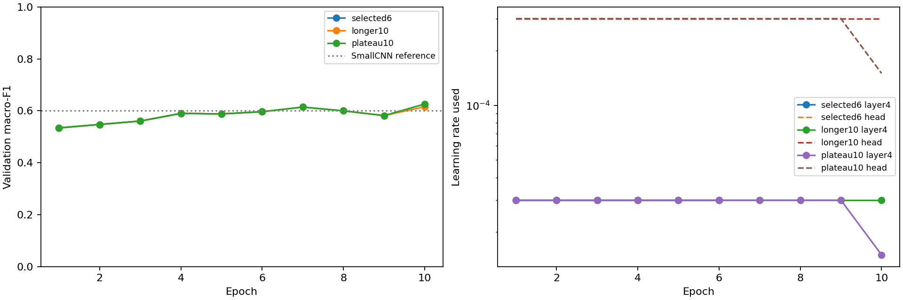

# ResNet18 optimisation: selected rates, longer training and scheduling

## Protocol

Three fresh fits from the same checksum-pinned frozen checkpoint, original train/validation only, seed 2112, batch 64, Adam, four CPU threads, fixed BatchNorm and earlier stages. Head/layer4 rates start at 0.0003/0.00003. No original test inference, augmentation, new CV selection or additional seed checks.

- `selected6`: reproduce the historical six-epoch settings, patience two, 720-second cap. The historical CV report supplies the chosen settings; the absent historical CV summary was not recreated or claimed independently reverified.
- `longer10`: raise the epoch cap to ten and patience to four, 1,200-second cap. This tests a longer-training protocol rather than isolating only the epoch setting.
- `plateau10`: match longer10 and halve both rates after two non-improving validation macro-F1 epochs; minimum rate 1e-7. Other settings stay fixed.

Caps are checked between epochs; checkpoint verification adds overhead. All plans were recorded before training. The existing original CV-selected script and its evidence guard remain unchanged. The general layer4 runner now accepts bounded longer plans and an optional scheduler; old plans retain their explicit caps.

## Validation results

| Arm | Macro-F1 | Accuracy | Balanced accuracy | Missed faults / 1,492 | Normal false alarms / 1,496 | Best / completed epoch | Stop |
|---|---:|---:|---:|---:|---:|---|---|
| selected6 | 0.5965 | 0.7687 | 0.5705 | 206 | 72 | 6 / 6 | max_epochs |
| longer10 | 0.6158 | 0.7838 | 0.5816 | 217 | 52 | 10 / 10 | max_epochs |
| plateau10 | 0.6261 | 0.7908 | 0.5966 | 196 | 55 | 10 / 10 | max_epochs |
| SmallCNN: Fewer missed faults | 0.5964 | 0.7413 | 0.6183 | 82 | 240 | See baseline notebook | — |
| SmallCNN: Highest macro-F1 | 0.6012 | 0.7634 | 0.5934 | 170 | 112 | See baseline notebook | — |

## Decisions and interpretation

Highest recorded macro-F1 in this phase: **plateau10**, **0.6261**. Difference from the SmallCNN macro-F1 reference: **+0.0249**.
Its missed faults differ by +26 and normal false alarms by -57 relative to that SmallCNN. Retain these counts alongside the headline score.

The selected6/longer10 common validation-score prefix matches exactly: **True**. This checks that increasing the training allowance did not silently change the earlier optimisation path.

- selected6: LR reductions after epochs none; recorded elapsed training/run time 454.8 seconds.
- longer10: LR reductions after epochs none; recorded elapsed training/run time 907.3 seconds.
- plateau10: LR reductions after epochs [9]; recorded elapsed training/run time 928.1 seconds.

Scheduling changed macro-F1 by +0.0103 relative to the matched longer arm. A scheduler that never activates is not evidence that LR reduction helped.

These are validation-selected development results from one seed. Additional trials on the same validation partition can produce optimistic gains. A higher score here is not proof of a repeatable advantage, unseen-site generalisation or suitability for a fault-screening workflow. Extra-seed checks remain deferred and the test set remains reserved.

## Checkpoint verification and records

Every selected checkpoint reproduced all 2,988 saved validation predictions, including complete probability vectors; recomputed metrics match. Source snapshots and current source hashes matched per-run provenance when verified. Checkpoints, full predictions, raw images and environments remain ignored. The tracked JSON contains the per-class metrics, histories, plans, provenance, verification and ledger; the notebook explains the full progression.

## Training time and compute

| Arm | Run minutes | Epochs | Mean run seconds / epoch | Trainable parameters | CPU threads |
|---|---:|---:|---:|---:|---:|
| selected6 | 7.58 | 6 | 75.80 | 8,394,764 | 4 |
| longer10 | 15.12 | 10 | 90.73 | 8,394,764 | 4 |
| plateau10 | 15.47 | 10 | 92.81 | 8,394,764 | 4 |
| SmallCNN fewer missed faults | 2.77 | 30 | 5.54 | 47,820 | 4 |
| SmallCNN highest macro-F1 | 2.07 | 28 | 4.44 | 47,820 | 4 |

These are recorded run timings on four-thread local CPU, including validation and saving rather than pure training. SmallCNN timings are historical, not a controlled same-session hardware benchmark. Architecture, trainable parameters, completed epochs and optimisation steps all affect cost. Parameter counts do not measure FLOPs, energy or peak RAM. Separate phase timers are added for the subsequent adaptive trials.
