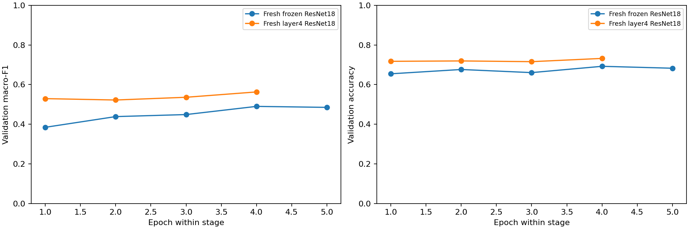

# Local ResNet18 reproduction and CNN comparison

Fresh CPU runs on the existing frozen split, seed 2112, batch 64, four threads. Official pretrained weights and full dataset bytes were checksum-verified. The original test set was not evaluated. Historical runs/checkpoints were not overwritten.

## Protocol

Frozen: Adam 0.001, at most five epochs/390 seconds, patience two, only the 6,156-parameter head trainable. Layer4: start from the exact new frozen checkpoint; head learning rate 0.0001, layer4 learning rate 0.00001, at most four epochs/480 seconds, patience two. BatchNorm remains frozen. Both stages use training-only square-root inverse-frequency loss weights and select by unweighted validation macro-F1.

Inherited smoke estimates in the frozen reproduction plan refer to the historical plan; the current smoke check took 0.583 s for 128 train images and 0.458 s for 128 validation images (2.719 s including setup). Full-run timings and software versions are stored in the tracked snapshot. The layer4 plan records its own current smoke measurement.

## Results

| Configuration | Macro-F1 | Accuracy | Balanced accuracy | Missed faults / 1,492 | Normal false alarms / 1,496 | Best / completed epoch |
|---|---:|---:|---:|---:|---:|---|
| Fresh frozen ResNet18 | 0.4900 | 0.6921 | 0.4925 | 299 | 156 | 4 / 5 |
| Fresh layer4 ResNet18 | 0.5629 | 0.7319 | 0.5784 | 184 | 162 | 4 / 4 |
| SmallCNN: Fewer missed faults | 0.5964 | 0.7413 | 0.6183 | 82 | 240 | See baseline notebook |
| SmallCNN: Highest macro-F1 | 0.6012 | 0.7634 | 0.5934 | 170 | 112 | See baseline notebook |

## Interpretation

Layer4 changed macro-F1 by +0.0729, missed faults by -115 and normal false alarms by +6 relative to the fresh frozen stage.

This evaluates a staged protocol, not an isolated architectural effect. The later historical CV-selected ResNet result (macro-F1 0.5965, missed faults 206, false alarms 72) remains separate; its chosen learning rates and six-epoch allowance were not rerun here. The strongest SmallCNN scheduler reference scores 0.6012 but trades 170 missed faults for 112 false alarms; the alternative SmallCNN reference misses 82 faults with 240 false alarms.

## Verification and limits

Both selected checkpoints exactly reproduce every saved original-validation prediction, including probability vectors. Recomputed metrics match saved metrics; current sources and per-run snapshots match provenance hashes. The new layer4 plan pins the new frozen checkpoint hash. Checkpoints and full predictions stay in ignored runs folders.

No additional random-seed checks or test inference were performed. Repeated selection on the same validation set and unequal budgets limit claims about which architecture is better. Missing site/panel identifiers still prevent a claim of unseen-site performance. The frozen checkpoint SHA-256 exactly matches the historical parent hash recorded in the original layer4 plan; this establishes byte identity for that checkpoint, while metric agreement alone does not establish identity for every historical artifact.

