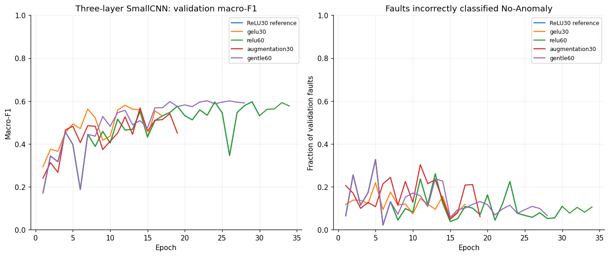

# Three-layer SmallCNN: GELU and longer training

Planned window: 23 October 2026, 17:09:49–17:29:49 Australia/Sydney (20 minutes). The initial reference is the recorded three-convolution BatchNorm/ReLU SmallCNN: Adam 0.001, weighted cross-entropy, batch64, seed2112, patience5. All arms use 47,820 trainable parameters and original train/validation only. No test inference or seed checks.

The first new trial changes ReLU to GELU at the same 30-epoch cap. Matched longer schedules permit 60 epochs and 450 seconds, keeping patience unchanged. A longer GELU run is redundant if the 30-epoch GELU arm already early-stops; any such skipped arm is recorded explicitly. New cap validation permits 60 epochs/450 seconds, but old plans retain their smaller limits.

| Arm | Epochs / selected | Accuracy | Macro-F1 | Balanced accuracy | Missed faults / 1,492 | Normal false alarms / 1,496 | Stop |
|---|---:|---:|---:|---:|---:|---:|---|
| ReLU30 reference | 30 / 29 | 0.7413 | 0.5964 | 0.6183 | 82 | 240 | max_epochs |
| gelu30 | 17 / 12 | 0.7470 | 0.5802 | 0.5822 | 177 | 121 | early_stopping |
| relu60 | 34 / 29 | 0.7413 | 0.5964 | 0.6183 | 82 | 240 | early_stopping |
| augmentation30 | 19 / 14 | 0.7423 | 0.5680 | 0.5723 | 209 | 134 | early_stopping |
| gentle60 | 28 / 23 | 0.7634 | 0.6012 | 0.5934 | 170 | 112 | early_stopping |

## Trial ledger

| Arm | Status |
|---|---|
| gelu30 | completed |
| relu60 | completed |
| gelu60 | not_run_redundant_early_stopping |
| augmentation30 | completed |
| gentle60 | completed |

## Decision record

- **gelu30:** macro-F1 -0.0162, missed faults +95, and normal false alarms -119 relative to the ReLU30 reference.
- **relu60:** macro-F1 +0.0000, missed faults +0, and normal false alarms +0 relative to the ReLU30 reference.
  The first 30 validation macro-F1 scores reproduce the previous ReLU reference exactly: True.
- **augmentation30:** macro-F1 -0.0284, missed faults +127, and normal false alarms -106 relative to the ReLU30 reference.
- **gentle60:** macro-F1 +0.0048, missed faults +88, and normal false alarms -128 relative to the ReLU30 reference.

Highest recorded macro-F1 in this comparison: **0.6012** from `smallcnn-depth-gentle60-s2112-v1`. This is a validation-selected, single-seed development result, not proof of a globally optimal model.

## Verification and limits

- Each completed checkpoint exactly reproduced its saved validation predictions after reload. Per-run source snapshots were checked against their provenance hashes.
- The existing 23-test suite passed 21 tests with two pre-existing skips; short GELU smoke training also succeeded. Full frozen dataset verification ran before training.
- A larger epoch/time allowance is not a guarantee of additional learning. Report actual completed epochs and early-stopping outcomes. Changes in missed faults and normal false alarms remain visible alongside macro-F1.
- The original test set remains unused. Repeated validation-based selection is optimistic; these results do not establish unseen-site performance.
- Checkpoints, full predictions and source snapshots remain in ignored runs folders. Tracked JSON supplies histories and metrics; the baseline notebook contains the protocol, plots and decisions.

## Decision: highest macro-F1 versus fewer missed faults

The gentler scheduler reached macro-F1 **0.6012** versus **0.5964**, and accuracy
**0.7634** versus **0.7413**. It reduced normal false alarms from **240 to112**,
but increased faults called normal from **82 to170** and reduced balanced
accuracy from **0.6183 to0.5934**. Retain both checkpoints with explicit roles;
do not describe the scheduler as better in every measure or as a safety advance.
The macro-F1 gain is only **0.0048** under one validation-selected seed.

GELU and the tested mild augmentation did not beat the reference. Increasing the
ReLU epoch cap did not improve the selected checkpoint because early stopping
still ended training at34. A more patient stopping trial was considered but not
run within the remaining runtime/reporting reserve. No additional fitting was
started after the original deadline.

